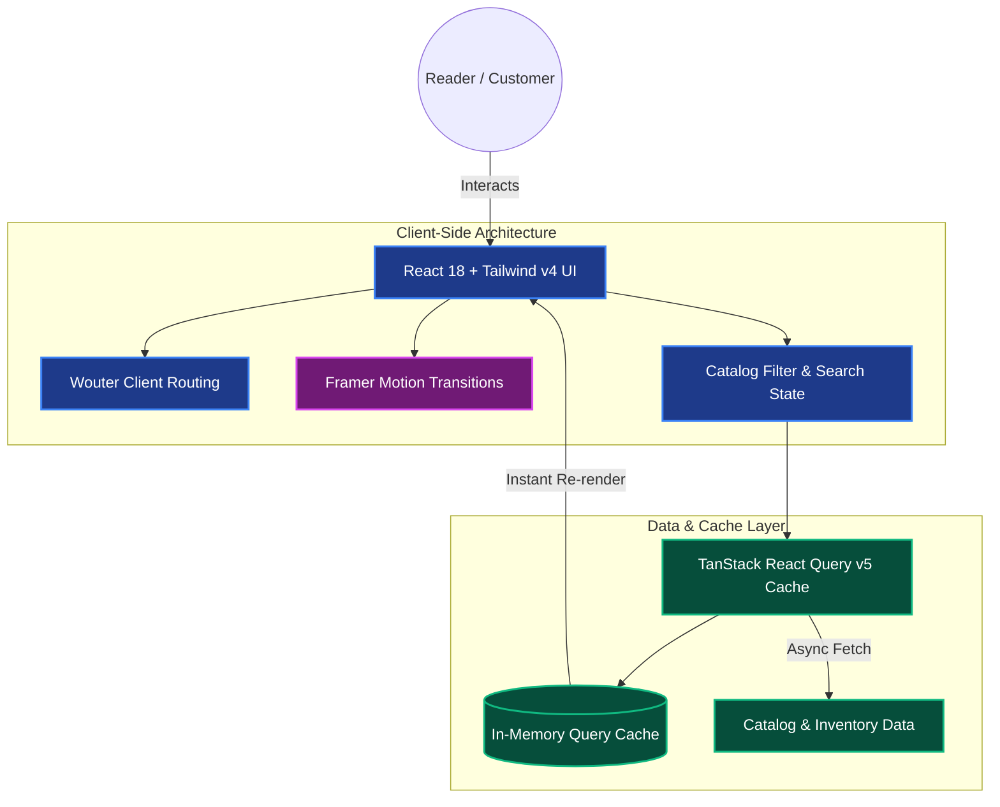

<div align="center">
  <h1>📚 BookShelf.pk — Modern Online Bookstore</h1>
  <p><strong>A high-performance e-commerce platform built with React 18, TypeScript, Vite, Tailwind CSS v4, and TanStack Query.</strong></p>

  <p>
    <a href="https://bookshelfonline.netlify.app/"></a>
    
    
    
    
  </p>
</div>

---

## 📖 Project Overview

**BookShelf.pk** is an interactive, modern online bookstore platform designed to deliver a smooth, responsive, and visually refined browsing experience.

Engineered with a modern frontend stack, this application emphasizes instant client-side transitions, intelligent server state caching, smooth UI micro-interactions, and strict TypeScript type-safety across the entire user shopping flow.

---

## ✨ Core Features & Technical Highlights

- ⚡ **Next-Gen Build Tooling**: Powered by **Vite 6** with `@vitejs/plugin-react` for instantaneous Hot Module Replacement (HMR) and optimized rollup production bundles.
- 🔄 **Intelligent Server State Synchronization**: Implements **`@tanstack/react-query` (v5)** for declarative asynchronous data fetching, automatic background refetching, and client-side caching.
- 🎨 **Modern Design & Micro-Interactions**: Styled using the cutting-edge **Tailwind CSS v4** engine paired with **`framer-motion`** for fluid page animations and **`lucide-react`** for iconography.
- 🛣️ **Lightweight Routing**: Utilizes **`wouter`** for minimalist, bundle-friendly client-side routing without the overhead of heavy router libraries.
- 🛡️ **Strict TypeScript Architecture**: Comprehensive static type checking across catalog models, component props, and state handlers.

---

## 🛠️ Technology Stack

### Frontend & State Management
* **React 18**: Concurrent rendering and modern component lifecycle hooks.
* **TypeScript 5.6+**: End-to-end static type-safety.
* **TanStack Query (React Query v5)**: Advanced caching and server state synchronization.
* **Wouter**: Ultra-lightweight client-side routing.
* **Framer Motion**: Smooth interactive layout animations.

### Styling & Tooling
* **Tailwind CSS v4**: High-performance CSS engine with typography plugin.
* **Vite 6**: Rapid frontend build tooling and development server.
* **Lucide React**: Clean vector icon suite.

---

## 🏗️ Application Architecture

<details>
<summary><b>View Frontend State & Query Architecture Diagram</b> (Click to expand)</summary>


</details>

---

## 💻 Local Development Setup

To explore and run this project locally:

### Prerequisites
- Node.js (v18.0.0 or higher)
- pnpm (recommended) or npm / yarn

### Installation

1. **Clone the repository:**
   ```bash
   git clone https://github.com/meet-muhammad-mateen/BOOK-SLEF.git
   cd BOOK-SLEF
   ```

2. **Install dependencies:**
   ```bash
   pnpm install
   # or: npm install
   ```

3. **Start the development server:**
   ```bash
   pnpm dev
   # or: npm run dev
   ```

4. **Build for production:**
   ```bash
   pnpm build
   ```

---

## 👨‍💻 Developed By

**Muhammad Mateen**  
*Full-Stack & Front-End Specialist*

- 🌐 **Live Portfolio**: [mmateenn.netlify.app](https://mmateenn.netlify.app/)
- 💼 **LinkedIn**: [muhammadmateen112](https://www.linkedin.com/in/muhammadmateen112/)
- 📧 **Email**: [meetmuhammadmateen@gmail.com](mailto:meetmuhammadmateen@gmail.com)